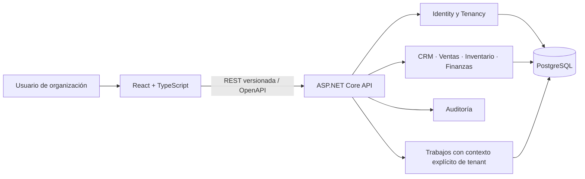

# Fase 0 — Descubrimiento, validación y spikes

**Estado:** en progreso; no se declara cerrada.
**Fecha de trabajo:** 2026-11-06.
**Fuente:** propuesta de producto v2. La v2 reemplaza las ambigüedades de la v1 y define H3 como el MVP.

## 1. Decisiones de producto recibidas

| Decisión | Resultado | Estado |
|---|---|---|
| Segmento inicial | ERP horizontal | Confirmado por el propietario |
| Mercado | México primero; expansión internacional posterior | Confirmado por el propietario |
| Multimoneda | Desde H3: moneda de reporte por organización y monedas transaccionales con tipo de cambio por documento | Interpretación aprobada; faltan fecha efectiva y redondeo |
| Finanzas del MVP H3 | Finanzas operativas, sin doble partida | Confirmado por el propietario |
| Equipo | Una persona a tiempo parcial, 10–20 horas por semana | Confirmado; usar el extremo bajo para planificación conservadora |
| Entidades legales | Una por organización en el MVP, con extensión futura | Confirmado por el propietario |
| Fiscalidad en H3 | No incluida; finanzas operativas | Confirmado por el alcance de H3 |
| PAC/proveedor fiscal | Solución Factible, Timbox y Tralix son candidatos documentales; no hay selección productiva | Comparar sandbox, contrato, soporte, continuidad y costos antes de H4 |

La decisión de alto nivel para la decisión 6 queda acotada: no habrá facturación fiscal en H3; reservar una interfaz de proveedor y elegirlo para H4. México queda confirmado como jurisdicción inicial; quedan pendientes la validación con asesoría fiscal/legal y la selección del proveedor.

## 2. Decisiones todavía necesarias

| Tema | Pregunta concreta | Bloquea |
|---|---|---|
| Multimoneda | Aprobado el modelo de moneda de reporte por organización y monedas transaccionales múltiples con tipo de cambio por documento. | Confirmado; faltan reglas de fecha efectiva y redondeo para H3 |
| OIDC | Comparar proveedor externo, política MFA, presupuesto y eventual venta de SSO/SCIM. La v2 propone proveedor externo. | Diseño de identidad H1 |
| MFA | Confirmar política por rol de la sección 8.2 de v2 antes de H1. | Identidad H1 |
| Roles | La v2 propone roles base más roles personalizados; confirmar antes de cerrar autorización H1. | Autorización H1 |
| Idiomas | La v2 propone es-MX y textos externalizados; para expansión internacional, el primer piloto puede requerir es-MX e inglés. | Interfaz H1/H2 |
| Diferenciación | Validar una hipótesis con entrevistas; no aprobarla desde escritorio. | Cierre Fase 0 |
| PAC | México está confirmado; comparar proveedor, obligaciones, sandbox y contrato con asesoría fiscal/legal. No se inicia trabajo fiscal todavía. | H4 |

## 3. Investigación competitiva preliminar

Es un desk research de fuentes oficiales, actualizado el 2026-11-06. No reemplaza pruebas de producto, demos ni entrevistas. México es el primer mercado elegido; precios y funciones deben volver a comprobarse antes de seleccionar producto o proveedor.

| Alternativa | Señal competitiva observada | Lectura para AES Nexus |
|---|---|---|
| Oracle NetSuite | Integra finanzas con pedidos, inventario, CRM y comercio; cubre consolidación, operación multimoneda y administración global. [Oracle: gestión financiera](https://www.netsuite.com/portal/products/erp/financial-management.shtml) | Referencia funcional del producto solicitado. La oportunidad no puede ser sólo “un NetSuite más sencillo”; debe probar un segmento y una ventaja de onboarding/costo. |
| Odoo | Suite amplia con CRM, ventas, contabilidad e inventario. Su página muestra todas las apps por usuario y diferencia el plan personalizado por multiempresa/API/hosting; implementación y servicios pueden tener costos aparte. [Planes oficiales](https://www.odoo.com/es/pricing) | Compite en amplitud y modularidad; estudiar esfuerzo de configuración y dependencias locales en el país objetivo. |
| Zoho One / Zoho CRM | Zoho One agrupa más de 50 apps con modelos de precio por usuario flexible o por toda la plantilla; Zoho CRM ofrece pipelines múltiples, workflows y automatización de ventas. [Zoho One](https://www.zoho.com/one/pricing/), [Zoho CRM](https://www.zoho.com/crm/zohocrm-pricing-standard.html) | Competidor de suite de negocios y CRM; el usuario podría ensamblar su ERP con varias apps conectadas. Medir integración y costo total, no sólo precio de CRM. |
| HubSpot | CRM gratuito para hasta 2 usuarios y oferta Starter por asiento; cubre productos de marketing, ventas, servicio y contenido. [Planes CRM](https://www.hubspot.com/pricing/crm/) | Presión fuerte en la entrada comercial de bajo costo y facilidad de prueba; no equivale por sí solo a un ERP financiero/inventario completo. |
| Alegra | En México posiciona facturación/POS y ERP con contabilidad, inventario, bancos y conciliación. Publica planes desde MXN $187/mes para facturación (anual, más IVA) y MXN $974/mes para ERP (anual, más IVA). [Planes México](https://www.alegra.com/mexico/precios/) | Referente local de entrada por precio y escalamiento desde facturación a ERP. |
| Bind ERP | Se posiciona para comercio/distribución en México: ventas, inventario, compras, CFDI y cobranza, con puesta en marcha asistida. [Producto](https://bind.com.mx/erp), [Ventas](https://bind.com.mx/erp/sistemas-de-ventas), [Precios](https://www.bind.com.mx/precios) | Referente local para distribución, multialmacén y onboarding acompañado; contrasta con una propuesta horizontal/autoservicio. |

### Hipótesis de diferenciación por validar

**Hipótesis, no decisión:** AES Nexus podría ofrecer un flujo unificado desde prospecto hasta cobro con módulos activables, controles de permisos y configuración inicial guiada, con menos costo de implementación que los ERP amplios. La propuesta debe competir por un caso de uso concreto; un alcance horizontal sin foco inicial dificulta el posicionamiento. No considerar IA como diferenciador inicial hasta validar privacidad, proveedor y costo.

**Pendiente de validación:** entrevistas, pruebas de prototipos, evaluación real de onboarding y costos por equipo. Las entrevistas deben validar si una solución horizontal tiene sentido frente a necesidades verticales.

## 4. Plan de entrevistas

La propuesta exige al menos 8 entrevistas con usuarios potenciales. No se han realizado ni se deben reportar como realizadas. El propietario debe reclutar participantes; no contactaré personas externas sin autorización.

### Reclutamiento propuesto

Entrevistar a dueños, responsables de ventas y responsables operativos de PyMES mexicanas que hoy usan hojas de cálculo, un CRM y/o un sistema de facturación/ERP. Muestreo sugerido: cuatro empresas de servicios/consultoría y cuatro de comercio/distribución para probar si el alcance horizontal se sostiene. Incluir empresas con ERP pagado y empresas que dependan principalmente de hojas de cálculo.

### Guion no dirigido (30–40 min)

1. Cuéntame cómo pasa una venta reciente desde el primer contacto hasta el cobro.
2. ¿Qué herramientas y archivos usó cada persona? ¿Dónde se recapturó información?
3. ¿Dónde se detuvo o retrasó el flujo y qué impacto tuvo?
4. ¿Cómo preparan una cotización, aplican descuentos y autorizan excepciones?
5. ¿Qué ocurre cuando cotizan o cobran en monedas distintas? ¿Cómo registran tipo de cambio y reportes?
6. ¿Qué información debe compartir ventas con inventario/compras/finanzas?
7. ¿Qué sistema intentaron implementar y cuánto tardaron en usarlo sin ayuda?
8. ¿Qué requisito local (impuestos, facturación, idioma, banco) fue difícil de resolver?
9. ¿Qué presupuesto y modelo de cobro aprobaría quien compra el sistema? ¿Qué alternativas evaluó?
10. Si mañana cambiara una sola parte del flujo, ¿cuál sería y por qué?

Registrar frases y hechos anonimizados, proceso actual, herramientas, frecuencia, impacto y disposición de pago. No presentar una pantalla y preguntar “¿te gusta?” como evidencia de demanda.

## 5. Alcance propuesto para validar

Estas definiciones siguen la propuesta v2 y no añaden contabilidad de doble partida ni fiscalidad al H3.

### H2 — Piloto comercial

- Terceros compartidos entre clientes y proveedores; contactos, prospectos, oportunidades y actividades.
- Artículos/productos y servicios, cotizaciones con vigencia/versiones y aprobación de descuentos, pedidos de venta.
- Conversión y snapshots al confirmar; estados de cotización y pedido separados.
- Importación CSV con vista previa y errores por fila; reportes comerciales claros.
- Demo con hasta 3–5 organizaciones piloto, con consentimiento para uso de datos ficticios o cargados por ellas.

### H3 — MVP operativo

- H2 más inventario por almacén, reservas, compras/recepciones y devoluciones.
- Entregas, documento de venta no fiscal o registro de factura externa, cobros parciales, CxC/CxP, gastos y reportes.
- Finanzas operativas, sin libro mayor/doble partida.
- Multimoneda aprobada a alto nivel: guardar importe y moneda transaccional, tipo de cambio asociado al documento, moneda de reporte de la organización e importe equivalente histórico. Falta definir fuente/fecha, conversiones y redondeo.
- No incluye facturación fiscal, conciliación bancaria, IA autónoma ni suscripciones.

### Criterios medibles iniciales

Valores propuestos a validar con entrevistas y capacidad real:

- Primer usuario puede completar configuración y emitir una cotización de prueba en menos de 60 minutos sin ayuda.
- El flujo de venta confirma un pedido sin recapturar tercero, líneas ni precios y conserva snapshots del documento.
- Ninguna consulta/API puede leer o modificar registros de otro tenant; pruebas de aislamiento como gate obligatorio de H1.
- Respuesta p95 de lecturas paginadas ≤500 ms y escrituras ≤1 s; se deben medir con volumen y entorno definidos antes de afirmar cumplimiento.
- Dashboard distingue cotizaciones, pedidos, documentos de venta y cobros; el valor no se rotula simplemente como “ventas” si mezcla ciclos.

## 6. Spike técnico y estado del entorno

| Comprobación | Resultado observado |
|---|---|
| Node.js / npm | Node v26.12.1 y npm 12.2.0 disponibles; el frontend React/Vite compila con `npm run build`. |
| .NET | SDK 10.0.403 disponible localmente. La política oficial identifica .NET 10 como LTS activo hasta el 14 de noviembre de 2028. [Política oficial .NET](https://dotnet.microsoft.com/es-es/platform/support/policy/dotnet-core) |
| Docker | Docker CLI 29.8.2 y Compose v5.6.0 disponibles. Docker Desktop 29.8.2 responde. |
| PostgreSQL | La imagen local `postgres:16-alpine` inició en contenedor efímero, `pg_isready` devolvió `accepting connections` y el contenedor se detuvo con `--rm`; no se publicó puerto ni se conservó volumen. |
| PostgreSQL CLI / EF | `psql` no está instalado. EF Core/Npgsql, migraciones y consultas no están probados; tampoco hay backend todavía. |
| Repositorio | Git local inicializado en `main`; sin remoto configurado ni CI/CD. |

**Conclusión técnica:** React/TypeScript compila, .NET 10 SDK está instalado y PostgreSQL 16 inicia y acepta conexiones en un contenedor local efímero. Esto reduce el riesgo de entorno, pero no valida EF Core/Npgsql, migraciones, aislamiento multi-tenant, autorización ni despliegue.

### Identidad OIDC: candidatos para spike de H1 (sin decisión)

La propuesta recomienda un proveedor OIDC externo. Para un SaaS B2B con una persona desarrollando a tiempo parcial, conviene comparar proveedores administrados y conservar en la aplicación propia la membresía, `TenantId` y autorización de dominio. No se debe usar la organización del proveedor de identidad como única fuente de aislamiento.

| Candidato | Señales observadas en documentación oficial | Preguntas para el spike |
|---|---|---|
| WorkOS AuthKit | Gestión de usuarios, organizaciones, MFA, RBAC y políticas por organización; SSO/Directory Sync se cotiza por conexión. [Precios](https://workos.com/pricing), [SSO](https://workos.com/docs/authkit/sso) | Flujo React + API .NET, claims de organización, costo si ningún cliente requiere SSO empresarial |
| Auth0 | OIDC, Organizations, MFA y RBAC por organización; la página pública separa planes y límites B2B. [Precios oficiales](https://auth0.com/pricing) | Límites reales para tenants, precio al activar MFA/B2B, exportación y portabilidad |
| Clerk | SDK React y funciones B2B (organizaciones, miembros, roles); funciones B2B ampliadas y SSO tienen cuotas/adicionales según plan. [Precios oficiales](https://clerk.com/pricing) | Integración del token con ASP.NET Core, límites de organizaciones, MFA requerido y costo por organización |
| Microsoft Entra External ID | Identidades externas con cobro base por usuarios activos mensuales y complementos; algunas capacidades de residencia regional tienen disponibilidad limitada. [Documentación de precios](https://learn.microsoft.com/en-us/entra/external-id/external-identities-pricing) | Requisitos de región del primer país, MFA, branding, experiencia de alta y complejidad operativa de Azure |

**No se selecciona un proveedor de identidad en esta Fase 0.** México ya está definido; falta cerrar presupuesto, política MFA y si se venderá SSO/SCIM a clientes. La prueba de concepto debe verificar validación JWT/JWKS en .NET, expiración/rotación de claves, flujo de alta/invitación y membresías en la base propia.

### Spike fiscal para México: comparación documental de PAC

El directorio vigente del SAT incluye a Solución Factible, Timbox y Tralix. Finkok no apareció en la consulta del listado actual y no se considera candidato hasta confirmar su estatus directamente con el SAT; existe documentación histórica, pero no basta para acreditar autorización vigente. Antes de contratar se deberá volver a comprobar el estado de autorización y el nombre comercial; el SAT indica que se requieren RFC y certificado de sello digital. [Lista SAT](https://wwwmat.sat.gob.mx/consulta/30795/consulta-los-proveedores-de-facturas-electronicas), [requisitos para emitir](https://wwwmat.sat.gob.mx/tramites/84057/genera-facturas-para-tu-empresa), [consideraciones para contratar un PAC](https://wwwmat.sat.gob.mx/consulta/73637/contribuyentes-interesados-en-utilizar-los-servicios-de-un-proveedor-autorizado-de-certificacion-de-facturas-electronicas).

| Candidato | Documentación técnica pública | Precio público observado | Preguntas restantes |
|---|---|---|---|
| Timbox | Aparece en el directorio vigente del SAT. La documentación pública consultada no fue suficiente para validar el alcance del sandbox/API. [SAT](https://wwwmat.sat.gob.mx/consulta/30795/consulta-los-proveedores-de-facturas-electronicas) | No se verificó precio público de integración/API; solicitar cotización y condiciones. | Solicitar documentación oficial de CFDI 4.0, sandbox, retries, cancelación, límites, SLA, tratamiento de XML/CSD y soporte. |
| Solución Factible | Aparece en el directorio vigente del SAT. Webservice CFDI 4.0 con endpoints de prueba/producción y métodos de timbrado, cancelación, consulta y descarga XML/PDF. [SAT](https://wwwmat.sat.gob.mx/consulta/30795/consulta-los-proveedores-de-facturas-electronicas), [CFDI 4.0](https://deployer.solucionfactible.com/sfic/capitulos/emision/ws-cfdi_33.jsp) | No se verificó precio público de API; pedir cotización por volumen, emisores, soporte y mínimos. | Validar sandbox, SOAP/.NET, retries, cancelación, límites, SLA, tratamiento de XML/CSD y disponibilidad de soporte. |
| Tralix | Aparece en el directorio vigente del SAT. Publica manual de timbrado PAC CFDI 4.0, WSDL y endpoints de prueba/productivos. [SAT](https://wwwmat.sat.gob.mx/consulta/30795/consulta-los-proveedores-de-facturas-electronicas), [manual](https://wiki.tralix.com/books/pac/page/timbrado-pac) | No se verificó precio público comparable; solicitar cotización. | Probar credenciales/sandbox, cobertura CFDI y complementos requeridos, cancelación, límites, SLA, tratamiento de XML/CSD y soporte. |

**Resultado:** Solución Factible, Timbox y Tralix forman la lista corta documental; ninguno fue elegido. Se cotejó el directorio actual del SAT y documentación pública disponible. No se ejecutaron llamadas al sandbox ni se validó un contrato. No se enviaron RFC, certificados, XML de clientes ni datos reales. Finkok queda fuera hasta aclarar por qué no aparece en el directorio vigente.

Un asesor fiscal/abogado debe revisar contrato, responsabilidades del PAC, conservación y exportación del XML, cancelación/sustitución, complementos de pago, moneda y tipo de cambio, manejo de certificados, datos personales y contingencia por revocación o indisponibilidad. En pagos diferidos/parciales, el SAT establece reglas y plazos del CFDI con complemento de pagos; esto se debe coordinar con el ciclo financiero del ERP. [Regla SAT de pagos](https://wwwmat.sat.gob.mx/articulo/22029/regla-2.7.1.35), [Complemento de pagos](https://wwwmat.sat.gob.mx/consultas/92764/comprobante-de-recepcion-de-pagos).

## 7. Arquitectura propuesta

Monolito modular, un runtime backend, límites por módulo y `TenantId` obligatorio en datos de negocio. El aislamiento se hará primero en aplicación y base de datos; RLS se considera defensa adicional, no sustituto de autorización. La implementación del modelo se difiere hasta confirmar moneda y proveedor de identidad.

## 8. Reestimación

La propuesta original estima **28–40 semanas** (hasta 44 con H3b) asumiendo 2–3 personas a tiempo completo. Con un supuesto de 40 horas por persona a tiempo completo, la extrapolación lineal a 10–20 horas semanales daría 112–480 semanas antes de ajustar sinergias y trabajo no lineal; es demasiado amplia para servir como compromiso. No fijaré fecha hasta convertir las historias priorizadas en estimaciones con la capacidad real. La secuencia debe priorizar un piloto estrecho y diferir lo opcional.

## 9. Condiciones de cierre de Fase 0

- [x] Segmento registrado: ERP horizontal.
- [x] Mercado registrado: México primero, expansión internacional posterior.
- [x] Alcance financiero: finanzas operativas.
- [x] Capacidad registrada: una persona a tiempo parcial.
- [x] Multimoneda de alto nivel: una moneda de reporte por organización y monedas transaccionales con tipo de cambio por documento.
- [ ] Completar reglas de multimoneda: fuente/fecha del tipo de cambio, conversiones y redondeo.
- [x] México como primer país; expansión internacional posterior.
- [ ] Alcance de H2/H3 y criterios validados con usuarios piloto.
- [ ] Prototipo del flujo principal validado con usuarios.
- [ ] Al menos 8 entrevistas y síntesis de problemas, herramientas y disposición de pago.
- [x] Desk research de seis alternativas globales/regionales para México.
- [ ] Diferenciación validada y análisis competitivo contrastado con entrevistas.
- [x] Decisión de Fase 0 sobre fiscalidad: sin facturación fiscal en H3; México y evaluación del proveedor para H4.
- [x] Spike documental de PAC: SAT vigente y documentación de Solución Factible, Timbox y Tralix revisadas; proveedor final pendiente.
- [ ] Pruebas sandbox y revisión legal/fiscal de PAC.
- [x] Decisión de entidad legal: una por organización en H3, modelo ampliable.
- [x] Finanzas operativas en H3, sin doble partida.
- [x] Capacidad: una persona, 10–20 horas por semana; usar 10 h/semana para calendarizar conservadoramente.
- [ ] Decisión de autenticación OIDC y política de MFA antes de H1.
- [x] Viabilidad básica de PostgreSQL local: servicio inicia y acepta conexiones; contenedor temporal detenido.
- [ ] EF Core/Npgsql, migraciones y pruebas de permisos/aislamiento multi-tenant.
- [ ] Backlog y fecha reestimados con horas semanales disponibles.

El plan permanece **En progreso** hasta cerrar los puntos pendientes. No se inicia H1 con proveedor de identidad sin seleccionar y no se implementa H3 sin cerrar las reglas de moneda.

### Ficha para resumir cada entrevista (sin nombres ni datos personales)

| ID | País/mercado | Tipo de empresa | Rol | Flujo reciente observado | Herramientas usadas | Fricción e impacto | Alternativa evaluada | Precio/modelo citado | Evidencia textual anonimizada |
|---|---|---|---|---|---|---|---|---|---|
| U01 | — | — | — | — | — | — | — | — | — |
| U02 | — | — | — | — | — | — | — | — | — |
| U03 | — | — | — | — | — | — | — | — | — |
| U04 | — | — | — | — | — | — | — | — | — |
| U05 | — | — | — | — | — | — | — | — | — |
| U06 | — | — | — | — | — | — | — | — | — |
| U07 | — | — | — | — | — | — | — | — | — |
| U08 | — | — | — | — | — | — | — | — | — |
